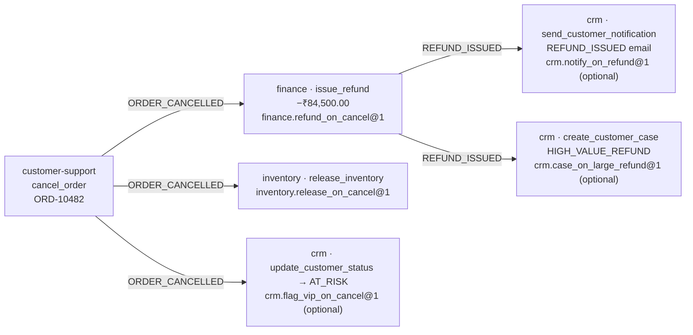
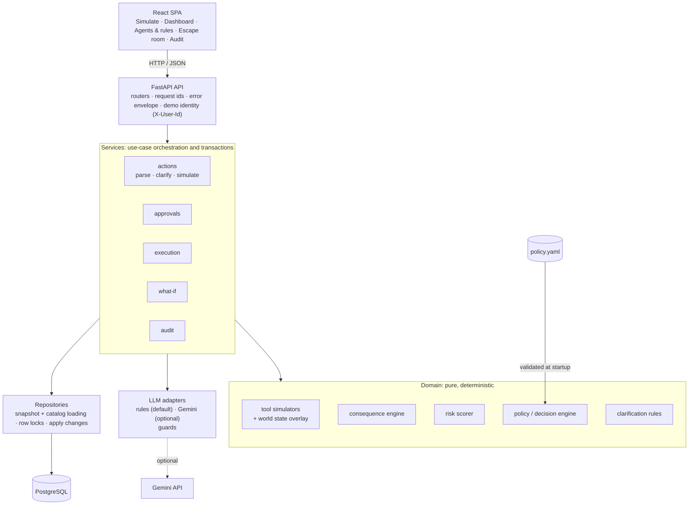

# Cascade

**See what an AI agent's action will set off before it runs, then let policy and a human decide.**

Agents rarely act alone. When a support agent cancels an order, a finance agent refunds it, an inventory agent releases stock and a CRM agent emails the customer. Each of those steps may be allowed on its own, and the combined result can still be one nobody approved.

Cascade sits between an agent's proposed tool call and its execution. It simulates the call against a copy-on-write view of business state, follows every downstream agent reaction it would trigger, and measures the result: money moved, agents involved, records touched and what can be undone. A deterministic risk model and a YAML policy then decide whether the action is blocked, auto-approved, or needs a human with enough authority.

It runs end to end on a seeded e-commerce company, NovaCart, with five agents, fourteen tools and fifteen declared reaction rules. An LLM can turn a sentence into a tool call and narrate the result. It never computes money, permissions, risk, graph structure or approval.

---

## The problem

Agent permission systems usually answer one question:

> Can Agent A call Tool B?

That question misses most of the risk. The question that matters is:

> What happens if Agent A calls Tool B **with these exact parameters**, right now?

A tool allowlist can't see:

- **downstream actions**, the other agents that react to what this one did
- **money movement**, how much leaves the business across the whole chain
- **inventory and record changes** several steps away from the original call
- **customer impact**, such as emails, cases and status changes
- **irreversible effects** mixed in with reversible ones
- **cascading behaviour**, including loops and duplicate work between agents

## The solution

Cascade adds a consequence step between *proposed* and *executed*:

```
natural-language request
  → structured tool call            (rules parser or Gemini; untrusted)
  → validation and clarification     (schema, allowlist, entity checks; never guesses)
  → deterministic simulation         (copy-on-write overlay; the database is not written)
  → consequence graph                (event → agent reaction rule → tool, authorized per node)
  → blast radius                     (measured facts)
  → risk score                       (documented formula over the blast radius)
  → policy decision                  (BLOCKED · APPROVAL_REQUIRED · AUTO_APPROVED)
  → human approval, when required    (role, limit, no self-approval, expiry)
  → revalidation                     (row locks, re-simulation, fingerprint and graph comparison)
  → execution                        (the verified changes, one savepoint per step)
  → audit                            (every step, with request ids)
```

**Simulation is not execution.** Simulating reads business state and writes only governance records: the action, its immutable report, the risk assessment and audit entries. Orders, payments, inventory and customers change only during execution, and only after an auto-approval or a human approval.

## Why Cascade is different

- **Deterministic consequence simulation.** The same input always produces the same report and fingerprint, down to the byte. The graph explains the decision, so nothing has to be reconstructed after the fact.
- **One implementation per tool.** Each tool has one simulator. Preview and execution both use it, so the preview can't drift away from what actually runs.
- **Copy-on-write world state.** Simulators read through an overlay on an immutable snapshot. Later steps see the effects of earlier ones, and the database isn't touched.
- **Explicit reaction rules.** Multi-agent behaviour is declared data: "when event E occurs and condition C holds, agent A calls tool T". Every downstream node names the rule and version that created it.
- **Per-node authorization.** Permissions are checked on every node, not only the first call. An unauthorized downstream step blocks the action at the exact node where it occurs.
- **Explainable, policy-driven risk.** Five weighted dimensions computed from the blast radius, with thresholds and weights loaded from `policy.yaml`. Every decision comes with stable reason codes and plain sentences.
- **Stale-state protection.** An approval covers a specific state of the world. If that state changes before execution, nothing is applied and the action needs a fresh simulation and a fresh approval.
- **A constrained LLM boundary.** LLM output is schema-validated, checked against the allowlist and re-validated by the backend. Narratives that cite figures not in the report are thrown away.
- **Auditability.** Parses, decisions, denials, approvals and executions are written to an insert-only audit log, each with the request id.

## A decision through Cascade

### Request

The customer-support agent proposes:

> "Cancel ORD-10482, customer wants out"

ORD-10482 is an ₹84,500 order from a VIP customer. The payment has been captured and stock is reserved.

### What Cascade sees

The parser turns the sentence into `cancel_order {order_id: "ORD-10482"}`, and the acting agent comes from the request, not from the text. Simulating `cancel_order` emits an `ORDER_CANCELLED` event. Three agents have reaction rules subscribed to that event, and the Finance refund emits `REFUND_ISSUED`, which triggers two more CRM rules.

### Consequence graph



### Blast radius

| Measure | Value |
|---|---|
| Money out | ₹84,500.00 |
| Other agents affected | 3 (finance, inventory, crm) |
| Downstream actions | 5 |
| Reversibility | PARTIAL (some steps can be undone, some cannot) |

### Risk

| Dimension | Score | Weight |
|---|---|---|
| Financial | 93.8 | 0.35 |
| Irreversibility | 50 | 0.20 |
| Downstream agents | 75 | 0.15 |
| Customer impact | 80 | 0.20 |
| Data sensitivity | 60 | 0.10 |
| **Total** | **76 · HIGH** | |

Every weight, breakpoint and band comes from [`backend/policy/policy.yaml`](backend/policy/policy.yaml). The scorer has no constants of its own.

### Decision

**APPROVAL_REQUIRED**, for two reasons:

- `REFUND_ABOVE_AUTO_LIMIT`: "₹84,500.00 would leave NovaCart, above the ₹2,000.00 auto-approve limit."
- `HIGH_RISK`: "Risk is HIGH (76/100)."

An approval request opens with a 30-minute expiry. An approver whose limit is ₹10,000 is refused with `APPROVAL_LIMIT_EXCEEDED`. An approver whose limit is ₹1,00,000 can approve it.

### Execution

When an operator executes the approved action, Cascade:

1. locks the action row and every business row the simulation read
2. re-simulates the action against the locked, current state
3. compares the new state fingerprint and graph with the approved preview, and returns `409 STALE_STATE` without applying anything if either differs
4. applies the verified changes step by step, each in its own savepoint, checking every field's expected `before` value
5. records the execution attempt and the audit events

The order ends up `CANCELLED` and the payment `REFUNDED`, which are exactly the values shown in the preview.

## Architecture

Cascade is a modular monolith: one FastAPI backend, one React single-page app and one PostgreSQL database. There are no queues, microservices or graph database.



| Layer | Role |
|---|---|
| **Frontend** | React, TanStack Query, and React Flow with a dagre layout. It renders the graph, blast radius, risk, decision, what-if comparison, approvals and audit. It never calculates money or risk. |
| **API** | Thin FastAPI routers with typed request schemas, a single error envelope, request-id middleware and the demo identity header. |
| **Services** | Orchestrate each use case and own its transaction: parse → simulate → score → decide → persist → audit, then approval, locked execution and what-if. |
| **Domain** | Pure Python engines for simulators, world state, consequence traversal, risk, decision and clarification. An architecture test fails if this layer imports the database, HTTP, LLM or infrastructure code. |
| **LLM adapters** | A provider interface with three calls (`parse_intent`, `interpret_what_if`, `explain`) and two implementations: a deterministic rules provider and Gemini. All output goes through the guards. |
| **Repositories** | Load the immutable snapshot and catalog, lock rows in a deterministic order, and apply previewed changes with `before`-value checks. |
| **PostgreSQL** | The source of truth. Money columns are `NUMERIC(12,2)`, enum and value CHECK constraints are enforced in the database, mutable rows carry version columns, and reports are stored as immutable JSONB. |

## Core execution model

1. **Parse.** The rules provider or Gemini turns text into a structured intent. The output is validated against a strict schema, the tool catalog and the tool's own parameter model. Identity comes from the request.
2. **Validate.** The backend checks that required fields are present and that referenced entities exist. If something is missing or ambiguous (for example, "3 customers match 'John'"), Cascade asks a question with explicit candidates rather than guessing.
3. **Simulate.** The whole business state is loaded as an immutable snapshot, and the action runs on a copy-on-write overlay. Each read records the row's version. **Business state is read here and never written.**
4. **Analyze.** A breadth-first traversal over events and reaction rules builds the consequence graph. Every node is authorized, and the blast radius is measured from the nodes that will execute.
5. **Decide.** The risk scorer and policy engine produce a score, a level and a decision with reason codes. Authorization failures are hard blocks and are never weighed against risk.
6. **Approve.** If approval is required, a human with the APPROVER role and a high enough limit, who isn't the proposer, approves or rejects the action before the request expires.
7. **Revalidate.** At execution, the read rows are locked, the action is re-simulated, and the fingerprint and graph shape are compared with the approved preview.
8. **Execute.** **This is the only place business state is written.** Changes are applied in topological order, one savepoint per step.
9. **Audit.** Every transition is appended to the audit log with the actor, payload and request id.

## Determinism and safety

The LLM is kept outside the authoritative logic. It is an input device and a narrator.

**What the LLM does**

- turns a natural-language request into a structured intent (a tool name and flat parameters)
- turns "what if we did X instead?" into an alternative tool call
- optionally writes a short narrative of a report the backend has already computed

**What the LLM does not decide**

- money: amounts are decimal strings, and percentages are converted to rupees by the backend
- permissions or authorization, which the engine checks on every node
- risk scores or levels
- graph topology, which comes from declared reaction rules only
- approval, which is a policy decision plus a human

**The boundary**

- LLM output must match a strict JSON schema. Invented tools and unexpected parameters are rejected (`LLM_OUTPUT_INVALID`), and invalid output is never retried.
- The acting agent always comes from the request. If the text names a real tool the agent isn't allowed to call, Cascade still creates the action and the engine blocks it as `TOOL_NOT_PERMITTED`, so the attempt appears in the audit log.
- With Gemini, user text is sent as a field inside a JSON document, not mixed into the instructions. Gemini runs at temperature 0 with a JSON response schema.
- Every ₹ amount and percentage in a narrative must match a number in the computed facts. If any doesn't, the whole narrative is discarded and replaced with a deterministic template.
- A heuristic flags likely prompt-injection phrases (`INJECTION_SUSPECTED`) in the audit log. This is a signal for reviewers, not the defence.

These guards limit what LLM output can do. They don't make the LLM correct. A wrong but well-formed parse yields a well-formed action, and that action then goes through the same validation, simulation, policy and approval as any other.

## What-if analysis

From any simulated action you can ask for an alternative:

> "What if we give 20% compensation instead?"

Cascade interprets the question as a separate tool call for the same acting agent (`issue_compensation {order_id: "ORD-10482", percentage: "20"}`). It simulates that call as an independent child action and compares the two deterministically:

| | Cancel ORD-10482 | 20% compensation |
|---|---|---|
| Money out | ₹84,500.00 | ₹16,900.00 |
| Downstream actions | 5 | 1 |
| Risk | 76 HIGH | 53 MEDIUM |
| Decision | APPROVAL_REQUIRED | APPROVAL_REQUIRED (still above ₹2,000) |

The backend computes the ₹16,900.00. Neither simulation modifies business state, and the alternative is a real action that can be approved and executed on its own.

## Human approval

- **Roles.** `VIEWER` can read only. `OPERATOR` can propose and execute. `APPROVER` can also approve and reject.
- **Approval limits.** An approver's limit must be at least the action's money out (equal is enough).
- **No self-approval.** The proposer can't approve their own action.
- **Expiry.** A pending approval expires after the `approval_expiry_minutes` set in policy (30). Expiry is checked whenever the action is accessed.
- **Idempotency.** A repeated approve or execute returns the existing result and nothing is applied twice. A reused idempotency key with a different payload returns `409`.
- **Execution locks.** The action row and all business rows it read are locked `FOR UPDATE` in a fixed order.
- **Stale-state detection.** A different fingerprint, a different graph shape, or a newly blocked report returns `409 STALE_STATE`. Re-simulating opens a new approval, because approvals never carry over.
- **Rollback.** If a required step fails, the whole attempt rolls back (`FAILED`, retryable). If an optional step fails, that step and its descendants roll back and the rest is kept (`PARTIALLY_EXECUTED`).

The full mechanics are in [`docs/TECHNICAL_DESIGN.md`](docs/TECHNICAL_DESIGN.md#22-approval-model).

## Security

- Strict, typed tool parameters: unknown fields are forbidden, there is no type coercion, and money has at most two decimal places.
- Authorization on every node of the consequence graph, including expiry boundaries.
- Fail-closed handling of LLM output, with numeric checks on narratives.
- Approval boundaries enforced by the backend: role, limit, no self-approval, expiry.
- Stale-state protection under row locks.
- Database constraints: CHECKs on money, quantities and enums, plus foreign keys, unique keys and version columns.
- Explicit CORS origins (wildcards are refused at startup), sanitized request ids, and secrets held as `SecretStr` so they never appear in logs or repr output.
- An insert-only audit log, with no update or delete path in application code.

**Demo authentication.** The caller is identified by an `X-User-Id` header that names a seeded user. POST endpoints reject unknown users. GET endpoints are open. This is a demo identity mechanism, **not production authentication**. Real authentication (OIDC) is listed as post-MVP work in the blueprint. `DEMO_MODE` enables database reset and the Escape Room. Leave it off outside demos.

See [`docs/TECHNICAL_DESIGN.md`](docs/TECHNICAL_DESIGN.md#33-security-architecture) for the full security architecture.

## Tech stack

| Area | Technology |
|---|---|
| Backend | Python 3.11+, FastAPI, Pydantic v2, SQLAlchemy 2, Alembic |
| Database | PostgreSQL 16 (psycopg 3) |
| Graph | NetworkX for in-process execution ordering and depth |
| LLM | Deterministic rules provider (default) · Google Gemini via `google-genai` (optional) |
| Frontend | React 19, TypeScript, Vite, Tailwind CSS, TanStack Query, React Router, React Flow + dagre |
| Testing | pytest, mypy `--strict`, ruff · Vitest + Testing Library · Playwright |
| Runtime | Docker Compose locally (Postgres, migrate job, API, nginx-served SPA). The Cloud Run guide is in [`docs/DEPLOY.md`](docs/DEPLOY.md) |

## Running locally

### Docker

```bash
cp .env.example .env
docker compose up --build
```

- App: <http://localhost:5173>
- API docs: <http://localhost:8000/docs>

Compose starts Postgres, runs migrations, seeds NovaCart into an empty database, then starts the API and the nginx-served frontend. Nginx proxies `/api` to the backend.

The default `LLM_PROVIDER=rules` runs fully offline. To use Gemini, set `LLM_PROVIDER=gemini` and `GEMINI_API_KEY` in `.env`. If port 5432 is already taken, set `DB_PORT` in `.env` to a free port.

### Host development

Requires Python 3.11+, [uv](https://docs.astral.sh/uv/), Node 22, and Docker for Postgres.

```bash
make install
make db-up && make migrate && make seed
make dev-backend      # API on :8000
make dev-frontend     # Vite on :5173, proxies /api to :8000
```

Without `make` (for example, Git Bash on Windows):

```bash
cd backend && uv sync && uv run alembic upgrade head && uv run python -m app.seed
```

Demo users, selectable in the header: `ops-ravi` (operator), `approver-asha` (approver, ₹1,00,000), `approver-dev` (approver, ₹10,000), `viewer-kim` (viewer). For a 3-minute walkthrough, see [`docs/DEMO_SCRIPT.md`](docs/DEMO_SCRIPT.md).

## Testing

| Suite | Result | Command |
|---|---|---|
| Backend (unit, integration, API) | 311 passed | `REQUIRE_DB=1 make test-backend` |
| Frontend (components, layout, formatting) | 34 passed | `make test-frontend` |
| Playwright (end-to-end demo flows) | 7 passed | `make e2e` |

```bash
make check                 # ruff, ruff format, mypy --strict, eslint, tsc, pytest, vitest, build
bash scripts/check.sh      # the same gate without make (requires the database)
```

`make e2e` **resets the database** the backend points at, so it needs `DEMO_MODE=true`. One extra live Gemini smoke test is opt-in and skipped by default (`GEMINI_API_KEY=… uv run pytest -m live` in `backend/`). The normal suite never calls Gemini.

Every behaviour is a row in the [edge-case matrix](docs/EDGE_CASES.md) with its exact expected result and the test that proves it. Every row passes except the opt-in live Gemini test.

## Repository layout

```
backend/    FastAPI app: pure domain engines, services, repositories, LLM adapters, policy.yaml, tests
frontend/   React SPA and the Playwright end-to-end suite (frontend/e2e)
docs/       blueprint, technical design, edge-case matrix, demo script, deployment, progress log
scripts/    quality-gate runner and the test-database init script
```

## Documentation

| Document | Contents |
|---|---|
| [`docs/TECHNICAL_DESIGN.md`](docs/TECHNICAL_DESIGN.md) | Architecture in depth: engines, trust boundaries, execution safety, concurrency, trade-offs |
| [`docs/BLUEPRINT.md`](docs/BLUEPRINT.md) | The binding engineering blueprint (rev 2) |
| [`docs/EDGE_CASES.md`](docs/EDGE_CASES.md) | Edge-case matrix: ID, expected behaviour, proving test |
| [`docs/DEMO_SCRIPT.md`](docs/DEMO_SCRIPT.md) | 3-minute demo click path |
| [`docs/DEPLOY.md`](docs/DEPLOY.md) | Google Cloud Run deployment and environment variables |
| [`docs/PROGRESS.md`](docs/PROGRESS.md) | Build log, phase gates and recorded decisions |
