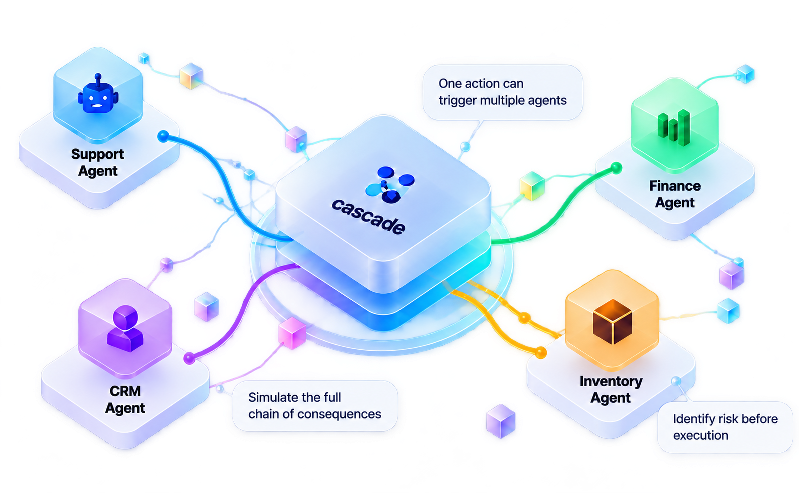
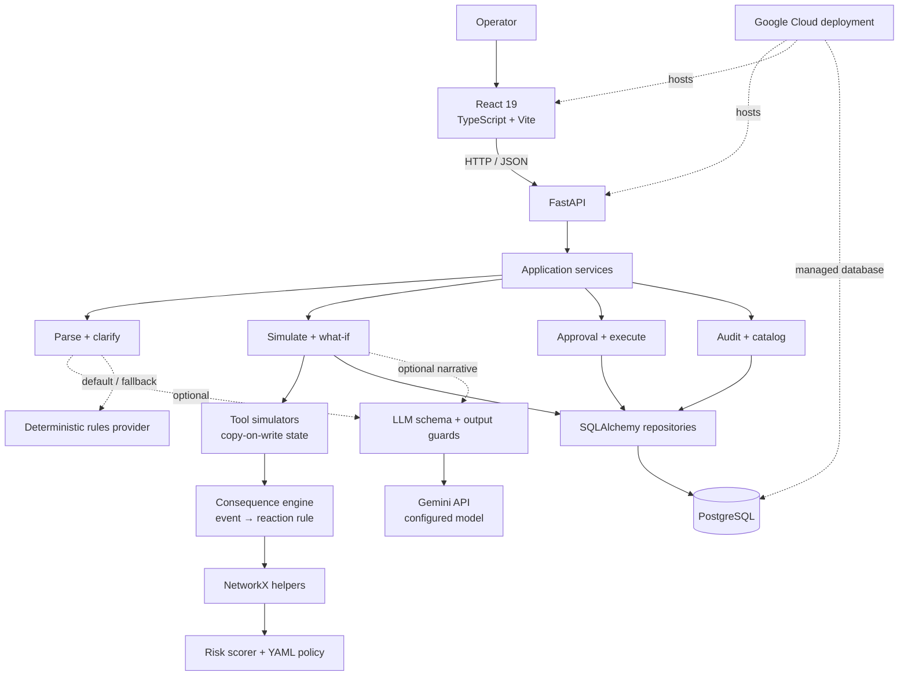
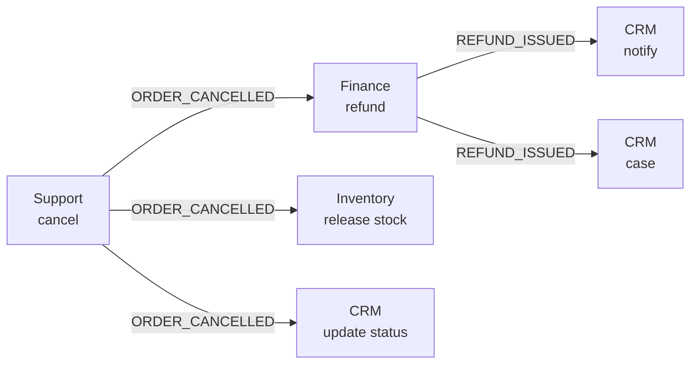
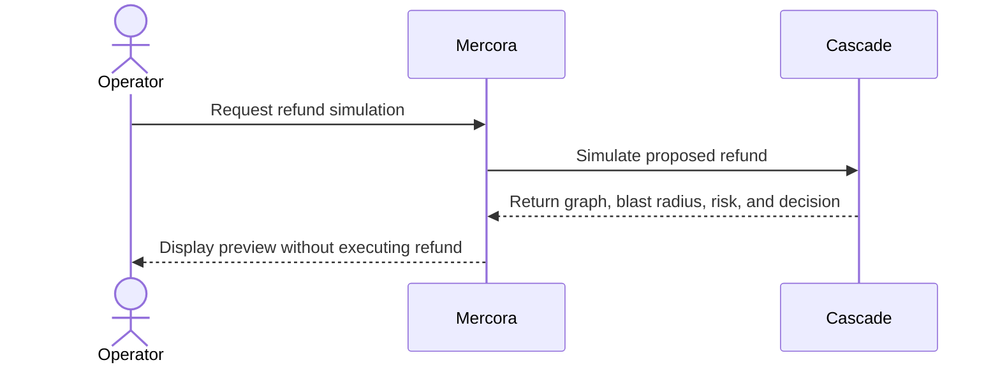

<p align="center">
  
</p>

<h1 align="center">Cascade</h1>

<p align="center"><strong>See what an AI agent’s action will set off before it runs. Then let policy and a human decide.</strong></p>

<p align="center">
  <a href="https://ai.google.dev/"></a>
  <a href="https://www.python.org/"></a>
  <a href="https://fastapi.tiangolo.com/"></a>
  <a href="https://react.dev/"></a>
  <a href="https://www.postgresql.org/"></a>
  <a href="https://ai.google.dev/gemini-api"></a>
  <a href="docs/DEPLOY.md"></a>
  <a href="https://www.docker.com/"></a>
  <a href="frontend/package.json"></a>
</p>

<p align="center">
  <a href="#demo">Demo</a> ·
  <a href="#architecture">Architecture</a> ·
  <a href="#getting-started">Quick Start</a> ·
  <a href="#documentation">Docs</a> ·
  <a href="#team">Team</a>
</p>

<p align="center">
  
</p>
<p align="center"><em>One permitted tool call can trigger a chain of agent actions. Cascade previews the chain first.</em></p>

<details>
<summary><b>Table of Contents</b></summary>

- [What Is Cascade?](#what-is-cascade)
- [What Makes It Different](#what-makes-it-different)
- [The Hidden Cascade](#the-hidden-cascade)
- [Demo](#demo)
- [Architecture](#architecture)
- [Google Cloud and Gemini Implementation](#google-cloud-and-gemini-implementation)
- [The Consequence Pipeline](#the-consequence-pipeline)
- [A Decision Through Cascade](#a-decision-through-cascade)
- [Determinism and Safety](#determinism-and-safety)
- [What-If Analysis, Human Approval, and Security](#what-if-analysis-human-approval-and-security)
- [Ecosystem: Mercora](#ecosystem-mercora)
- [Tech Stack](#tech-stack)
- [Getting Started](#getting-started)
- [Reproducible Testing](#reproducible-testing)
- [Repository Layout](#repository-layout)
- [Documentation](#documentation)
- [Team](#team)

</details>

> ### Explore the System
>
> [Technical design](docs/TECHNICAL_DESIGN.md) · [Deployment guide](docs/DEPLOY.md) · [Watch the demo video](https://drive.google.com/file/d/1sN-F9TT0Ke0mTdZJRb-CoeltACRN_oip/view?usp=sharing)

## What Is Cascade?

Agent permission systems usually answer: **Can Agent A call Tool B?** That check misses the risk that matters: what happens when the tool runs with these exact parameters, against the current state, and other agents react?

Cascade sits between a proposed tool call and execution. It simulates the action against a copy-on-write view of business state, follows enabled event-to-agent reaction rules, and measures the full blast radius: money movement, agents involved, records touched, customer impact, data sensitivity, and reversibility.

The result is an explainable consequence graph, a deterministic risk assessment, and a policy decision: `BLOCKED`, `APPROVAL_REQUIRED`, or `AUTO_APPROVED`. Simulation does not modify business state. When an action is approved, Cascade revalidates the preview against current state and configuration before applying it. This is a consequence control point, not a chatbot: Gemini can help parse or explain, but it does not compute money, permissions, risk, graph structure, or approval.

**Seeded demo scope:** 5 agents · 14 tools · 15 reaction rules.

## What Makes It Different

| Capability | Description |
|---|---|
| Full consequence graph | Breadth-first traversal follows emitted events through enabled reaction rules, including downstream agent tool calls. |
| Preview shares execution simulators | Each tool has one deterministic simulator used to derive preview effects and execution changes. |
| Per-node authorization | Every downstream agent and tool is checked against its own permission. An unauthorized node blocks the action at that node. |
| Measured blast radius | Money, downstream actions, agents, record changes, reversibility, customer impact, and data sensitivity come from simulated effects. |
| Policy-driven decisions | Five weighted risk dimensions, configured in YAML, produce a score, reasons, and a policy decision. Authorization failures remain hard blocks. |
| Approval tied to what was reviewed | Execution locks read rows and re-simulates. State, policy, reaction rules, and relevant tool/permission configuration must still match. |
| Constrained LLM boundary | Rules-based parsing is the default. Optional Gemini output is schema-validated and guarded; it cannot override deterministic decisions. |
| Alternatives and audit | What-if actions are simulated independently. Parse, decisions, approvals, denials, and execution are written to an append-only audit log. |

<details>
<summary><b>Design principles</b></summary>

- **Determinism:** the same input and configuration produce the same report and fingerprint.
- **Copy-on-write state:** downstream steps see earlier simulated effects while business rows stay untouched during preview.
- **Declared behavior:** reaction rules state which agent reacts to which event and which tool it calls.
- **Stale-state protection:** approvals bind to the business state and configuration used by the preview.
- **Explainability:** the graph records event, rule, agent, tool, authorization result, and simulation step.
- **Auditable control:** identity comes from the request context; every lifecycle transition is attributable by actor and request ID.

</details>

## The Hidden Cascade

The seeded NovaCart scenario starts with a simple request: **reduce the laptop quantity from two to one on `ORD-10550`**. Support is allowed to modify the order. That edit emits `ORDER_MODIFIED`; the Finance agent independently proposes a ₹72,000 refund under its own `finance.refund_on_downsize` reaction rule. The refund then triggers CRM actions. The permitted root action is reversible; the full consequence graph includes irreversible money movement and customer effects.

| Measure | Root action alone | Full consequence graph |
|---|---:|---:|
| Authorization | Support may call `modify_order` | Every triggered agent/tool checked on its own permission |
| Money out | ₹0 | ₹72,000 |
| Downstream actions | 0 | 5 |
| Other agents | 0 | Finance, Inventory, CRM |
| Reversibility | Full | Partial |
| Risk and decision | 10 · LOW · `AUTO_APPROVED` | 68 · HIGH · `APPROVAL_REQUIRED` |

Nobody requested the refund. Finance proposes it after seeing the order total decrease. Cascade displays the original call as the direct action and the later calls as agent-triggered nodes, with the reaction rule behind each edge. If Finance lacks refund permission, the same flow is blocked at the Finance node.

<p align="center"><em>A permitted order edit can trigger downstream finance, CRM, and inventory actions.</em></p>

## Demo

### Demo Video

▶ **[Watch the demo video](https://drive.google.com/file/d/1sN-F9TT0Ke0mTdZJRb-CoeltACRN_oip/view?usp=sharing)**

### Live Deployment

[](https://cascade-web-924106425649.asia-south1.run.app/)

**Companion app:** Mercora (commerce app that calls Cascade): [https://github.com/KRYSTALM7/Mercora](https://github.com/KRYSTALM7/Mercora) · [Live Mercora demo](https://demo-polish-web---mercora-web-gp5ciyqy6a-el.a.run.app/dashboard)

### Demo Users

| Demo user | Role | Approval limit |
|---|---|---:|
| Ravi Kumar (`ops-ravi`) | Operator · Support Ops | — |
| Asha Menon (`approver-asha`) | Approver · Finance Lead | ₹100,000 |
| Dev Patel (`approver-dev`) | Approver · Team Lead | ₹10,000 |
| Kim Lee (`viewer-kim`) | Viewer · Auditor | — |

Pick any demo user from the header selector to try each role: the operator proposes actions, approvers approve within their limit, and the viewer has read-only access. The live deployment runs in public mode, which keeps the shared demo data safe by turning off database reset and the Escape Room. Sign-in here is for demo purposes only, and production sign-in (OIDC) is on the roadmap.

## Architecture



| Layer | Responsibility |
|---|---|
| Frontend | React SPA for simulation, graph, blast radius, risk, approvals, what-if, and audit. It renders backend results. |
| API | FastAPI routes, request identity/context, response schemas, request IDs, and error handling. |
| Services | Coordinate parsing, validation, simulation, policy, persistence, approvals, execution, and audit. |
| Domain | Deterministic simulators, copy-on-write state, consequence traversal, risk scoring, policy, and clarification. |
| LLM adapter | Optional Gemini and default rules provider behind schemas, allowlists, budgets, and output guards. |
| Repositories and database | SQLAlchemy loads snapshots, locks relevant rows, applies verified changes, and persists reports and audit records in PostgreSQL. |

<details>
<summary><b>FastAPI route groups</b></summary>

| Routes | Purpose |
|---|---|
| `GET /healthz`, `GET /readyz` | Liveness and database readiness |
| `GET /api/agents`, `GET /api/agents/{agent_id}`, `GET /api/tools`, `GET /api/reactions` | Agents, tools, permissions, and reaction rules |
| `GET /api/orders`, `GET /api/orders/{order_id}`, `GET /api/policy` | Demo business state and active policy |
| `POST /api/actions/parse`, `POST /api/actions/simulate` | Parse a request or simulate a structured proposal |
| `POST /api/actions/{action_id}/clarify`, `POST /api/actions/{action_id}/what-if`, `POST /api/actions/{action_id}/approve`, `POST /api/actions/{action_id}/reject`, `POST /api/actions/{action_id}/execute` | Action clarification, alternative, approval, rejection, and execution |
| `GET /api/actions`, `GET /api/actions/{action_id}`, `GET /api/actions/{action_id}/consequences`, `GET /api/actions/{action_id}/audit` | Action detail, consequence report, and audit |
| `GET /api/audit`, `GET /api/users` | Global audit and demo identities |
| `GET /api/escape-room`, `POST /api/escape-room/{scenario_id}/run` | List/run demo adversarial scenarios; run is restricted in public mode |
| `POST /api/demo/reset` | Reset and reseed the demo dataset; restricted in public mode |

</details>

| PostgreSQL model group | Representative records |
|---|---|
| Catalog | Agents, tools, agent permissions, reaction rules, demo users |
| Business state | Customers, orders, order items, payments, inventory, refunds, restock requests, customer cases, notifications |
| Governance | Actions, consequence reports, risk assessments, approvals, execution attempts, append-only audit log |

Alembic has three revisions: baseline, domain model, and action explanation/report fields.

**Reading the diagram:** the browser submits a proposed action to FastAPI. Services invoke the deterministic domain, which simulates the root tool and traverses the consequence graph from declared reaction rules. The policy engine computes risk and the decision. Only after approval where required does execution lock rows, re-simulate, compare fingerprints, and apply the verified changes. Gemini is an optional input and explanation aid. The app is a modular monolith; there is no queue, microservice mesh, or graph database.

## Google Cloud and Gemini Implementation

### Gemini Usage

| Model | Where used | Purpose | Access method |
|---|---|---|---|
| `gemini-3.8-flash` (configurable) | Intent parsing, what-if interpretation, explanation | Return structured tool intent or a constrained narrative from precomputed facts | Official `google-genai` Python SDK `models.generate_content` |

`gemini-3.8-flash` is the application default in `backend/app/core/config.py`; `GEMINI_MODEL` can select a different model. Requests use JSON MIME type and a Pydantic-derived JSON schema at temperature `0`. Outputs are untrusted and pass through schema, tool allowlist, parameter, and unsupported-figure guards. Invalid model output is not repeatedly re-asked.

`LLM_CALL_LIMIT` caps Gemini calls per process per `LLM_CALL_WINDOW_SECONDS`. When the limit is reached, Gemini is unavailable, or guarded output is invalid, the deterministic rules provider handles the request. The default `LLM_PROVIDER=rules` requires no Gemini credential.

### Google Cloud Services

| Service | Purpose | What the repository implements |
|---|---|---|
| Cloud Run | Host API and web containers | Dockerfiles and deployment commands in [`docs/DEPLOY.md`](docs/DEPLOY.md) |
| Cloud SQL | Managed PostgreSQL | Cloud SQL connection for the API and migration job in deployment documentation |
| Artifact Registry | Container image storage | Build and push instructions for API and web images |
| Secret Manager | Deployment secrets | Instructions for database URL and optional Gemini/admin credentials |

Firebase Hosting, Vertex AI, Firestore, Pub/Sub, ADK, and Terraform are not part of this repository’s deployment implementation.

### SDK and Frameworks

- `google-genai` is the optional Gemini client; `temperature=0` and structured JSON responses constrain model output.
- FastAPI and Pydantic 2 implement typed HTTP endpoints and validation.
- SQLAlchemy 2, psycopg 3, and Alembic implement PostgreSQL persistence and schema migrations.
- NetworkX computes execution ordering and graph measures over the completed consequence report. The BFS event/reaction traversal is Cascade code.

## The Consequence Pipeline

Natural language parsing is optional. A structured tool call enters the same validation and deterministic consequence simulation.

```text
Operator request
      |
      v
I.   Parse intent (rules by default; Gemini optional)
      |
      v
II.  Validate tool, parameters, identity, and entities
      |    Missing or ambiguous details -> ask operator
      v
III. Simulate root tool on copy-on-write snapshot
      |
      v
IV.  Traverse event -> reaction rule -> agent tool
      |    Simulate and authorize every graph node
      v
V.   Measure the complete blast radius
      |
      v
VI.  Score risk and apply policy
      +--> BLOCKED ----------------------> Report + audit
      +--> AUTO_APPROVED ---------------> VII
      +--> APPROVAL_REQUIRED -> human -> VII
                                           |
                                           v
VII. Lock, re-simulate, compare, execute, audit
```

<details>
<summary><b>Stage I — Intent Parsing</b></summary>

**What it does:** Converts an operator’s sentence into one candidate tool call.

**Key details:** Rules parsing is the default and extracts only stated details. Gemini is optional and returns schema-constrained JSON. The acting agent comes from request context, never model text. Invalid or unavailable Gemini falls back to rules.

**Outputs:** Candidate tool ID and flat parameters, or unresolved intent for clarification/error handling; parser source is recorded.

</details>

<details>
<summary><b>Stage II — Validation and Clarification</b></summary>

**What it does:** Validates the tool, parameters, acting agent, permissions, and referenced entities.

**Key details:** Unknown fields, malformed values, and unauthorized tool calls are rejected. Missing or ambiguous entities trigger a clarification prompt with candidates; Cascade does not guess.

**Outputs:** Validated call ready to simulate, a clarification request, or a typed error/block.

</details>

<details>
<summary><b>Stage III — Snapshot and Tool Simulation</b></summary>

**What it does:** Simulates the proposed tool against a versioned snapshot using a copy-on-write overlay.

**Key details:** Tool simulators describe reads, changes, emitted events, money, reversibility, customer impact, and sensitivity. Later simulated steps observe earlier overlay changes. Preview does not write business rows.

**Outputs:** Root effect, overlay state, read versions, emitted events, and a state fingerprint.

</details>

<details>
<summary><b>Stage IV — Consequence Graph Traversal</b></summary>

**What it does:** Follows events through enabled reaction rules and simulates each resulting agent/tool proposal.

**Key details:** A deterministic breadth-first traversal evaluates matching conditions in stable order. Authorization is checked at every node. Rule mappings can use event fields. Duplicate work, graph limits, and cycles are represented in the report. NetworkX provides deterministic topological execution order.

**Outputs:** Consequence graph nodes and edges, node authorization, warnings and blockers, consulted rule/configuration fingerprints, and execution order.

</details>

<details>
<summary><b>Stage V — Blast Radius</b></summary>

**What it does:** Measures the effects of the full consequence graph.

**Key details:** The report aggregates money movement, affected agents, downstream actions, changed records, reversibility, customer impact, and data sensitivity. It also computes a direct-root view for comparison.

**Outputs:** Immutable consequence report and blast-radius facts for the UI and policy engine.

</details>

<details>
<summary><b>Stage VI — Risk and Policy Decision</b></summary>

**What it does:** Computes risk and returns `BLOCKED`, `APPROVAL_REQUIRED`, or `AUTO_APPROVED`.

**Key details:** Policy weights, breakpoints, thresholds, and limits load from `backend/policy/policy.yaml`. Authorization and simulator failures are hard blocks. Gemini does not set risk or make the decision.

<details>
<summary><b>Risk dimensions</b></summary>

| Dimension | Measures |
|---|---|
| Financial | Net money out against configured financial breakpoints |
| Irreversibility | Whether simulated steps can be undone |
| Downstream agents | Number of other agents triggered |
| Customer impact | Highest impact level in the graph |
| Data sensitivity | Most sensitive data touched by the graph |

</details>

**Outputs:** Score, risk level, dimension breakdown, policy version, decision, and stable reason codes.

</details>

<details>
<summary><b>Stage VII — Approval, Revalidation, Execution, and Audit</b></summary>

**What it does:** Collects approval if required and executes only the preview that still matches current state and configuration.

**Key details:** Approval checks role, limit, proposer separation, and expiry. Execution locks the action and read rows, re-simulates, compares business and configuration fingerprints, and applies changes in graph order using transaction savepoints. Stale previews return a conflict without applying business changes. Lifecycle events are appended to the audit log with request IDs.

**Outputs:** Approval decision, per-step execution status, stale/failed attempt details, and append-only audit entries.

</details>

## A Decision Through Cascade

The NovaCart hero cancellation starts with `ORD-10482`, a ₹84,500 VIP order with a captured payment. The support agent proposes `cancel_order`. The action emits `ORDER_CANCELLED`; Finance, Inventory, and CRM reaction rules propose downstream actions. A Finance refund emits `REFUND_ISSUED`, which can trigger CRM notifications and a case.



### Blast Radius

| Measure | Result |
|---|---:|
| Money out | ₹84,500 |
| Other agents affected | 3 |
| Downstream actions | 5 |
| Reversibility | Partial |

### Risk Assessment

<details>
<summary><b>Show risk dimensions and weights</b></summary>

| Dimension | Score | Weight |
|---|---:|---:|
| Financial | 93.8 | 0.35 |
| Irreversibility | 50 | 0.20 |
| Downstream agents | 75 | 0.15 |
| Customer impact | 80 | 0.20 |
| Data sensitivity | 60 | 0.10 |
| **Total** | **76 · HIGH** | — |

Values are the documented worked example in `backend/policy/policy.yaml`, `backend/tests/unit/test_policy_risk.py`, and `docs/TECHNICAL_DESIGN.md`.

</details>

### Decision and Execution

The decision is **`APPROVAL_REQUIRED`** because the ₹84,500 outflow exceeds the configured ₹2,000 auto-approve limit and the score is HIGH. An approver must have an adequate limit and cannot approve their own proposal.

On execution, Cascade locks the action and read rows, re-simulates, and compares the state, graph, policy, reaction rules, and relevant catalog fingerprints. If they differ, it returns `409 STALE_*` and applies nothing. If the preview is current, it applies the verified changes step by step and records the attempt.

<p align="center"><em>Approval is a backend control tied to the preview and its current policy.</em></p>

<p align="center"><em>A changed state or configuration requires a fresh simulation.</em></p>

## Determinism and Safety

The LLM is an input device and optional narrator. It is outside the authoritative simulation and policy path.

| Gemini may help with | Gemini does not decide |
|---|---|
| Parse natural language into a candidate tool and parameters | Money amounts or percentage calculations |
| Interpret a what-if question as a candidate alternative call | Agent identity or permissions |
| Explain a report using facts already computed by Cascade | Risk scores, bands, graph topology, or approval |

**The boundary:** model output must match a strict schema, use an allowed tool, and pass backend parameter and entity validation. The acting agent always comes from the request. Gemini requests use temperature zero and JSON schema; invalid output is not retried. Explanation figures must match computed facts or the whole narrative is replaced with a deterministic template. Prompt-injection heuristics are audit signals, not the security boundary.

**Demo authentication is not production authentication.** The seeded `X-User-Id` identities exist for judging the role and approval flows. They are not user authentication and must not be used with real customer or business data. In production mode, public-mode defaults restrict database reset, Escape Room runs, and API documentation. See [`docs/DEPLOY.md`](docs/DEPLOY.md) before publishing a deployment.

## What-If Analysis, Human Approval, and Security

### What-If Analysis

From a simulated cancellation, ask: **“What if we give 20% compensation instead?”** Cascade creates a separate alternative action for the same acting agent, computes its amount in the backend, and compares the results. Neither simulation changes business state.

| Measure | Cancel `ORD-10482` | 20% compensation |
|---|---:|---:|
| Money out | ₹84,500 | ₹16,900 |
| Downstream actions | 5 | 1 |
| Risk | 76 · HIGH | 53 · MEDIUM |
| Decision | `APPROVAL_REQUIRED` | `APPROVAL_REQUIRED` |

<p align="center"><em>A lower-risk alternative is a separate action; Cascade shows the trade-off for a human.</em></p>

### Human Approval

- **Roles:** `VIEWER` can read; `OPERATOR` can propose and execute; `APPROVER` can approve or reject.
- **Limits:** the approver’s configured limit must cover the action’s money out.
- **No self-approval:** the proposer cannot approve their own action.
- **Expiry:** pending approval expires at the policy-configured time.
- **Idempotency:** repeating an approval or execution does not apply changes twice.
- **Stale-state check:** changes to business data, policy, reaction rules, agents, tools, or permissions invalidate the preview.
- **Rollback:** required-step failure rolls back the attempt; optional-step failure can produce partial execution according to the recorded dependency graph.

### Security Controls

- Typed tool parameters reject unknown fields and invalid money precision.
- Authorization is checked at each consequence graph node.
- Backend policy decides block/approval/auto-approval; clients and LLM output cannot override it.
- Approval enforces role, limit, proposer separation, and expiry.
- Execution uses locks, re-simulation, fingerprints, and transactional savepoints.
- API errors use a structured envelope and request IDs; unexpected error details are not returned to clients.

## Ecosystem: Mercora

[Mercora](https://github.com/KRYSTALM7/Mercora) is an e-commerce operations app with a Cascade integration for refund consequence simulation. The [live Mercora dashboard](https://demo-polish-web---mercora-web-gp5ciyqy6a-el.a.run.app/dashboard) sends a scoped simulation request to Cascade and displays the returned blast radius, risk assessment, and policy decision.

Simulation is read-only: it does not modify the order or issue the refund. Mercora’s direct refund endpoint is disabled and returns **410 Gone**, enforcing the simulate-before-act workflow.



<p align="center"><em>Mercora demonstrates Cascade as a consequence preview service in an e-commerce workflow.</em></p>

<p align="center">
  <a href="https://github.com/KRYSTALM7/cascade">Cascade repository</a> ·
  <a href="https://github.com/KRYSTALM7/Mercora">Mercora repository</a>
</p>

## Tech Stack

| Area | Technology | Role |
|---|---|---|
| Backend | Python 3.11+, FastAPI, Uvicorn, Pydantic 2 | Typed API, orchestration, validation |
| Database | PostgreSQL 16, SQLAlchemy 2, psycopg 3, Alembic | Durable business, catalog, governance, and audit data |
| Consequence graph | Cascade BFS engine, NetworkX | Event/reaction traversal and graph algorithms |
| Policy | YAML, Pydantic | Risk weights, breakpoints, thresholds, and decision rules |
| LLM | `google-genai`, Gemini `gemini-3.8-flash` (optional) | Structured parse, what-if interpretation, constrained explanation |
| Frontend | React 19, TypeScript, Vite 8, React Router | Single-page application |
| Graph UI | `@xyflow/react`, `@dagrejs/dagre` | Interactive consequence graph and layout |
| Data fetching / styling | TanStack Query, Tailwind CSS 4 | API state and UI styling |
| Testing | pytest, Vitest, Playwright | Backend, component, and browser-flow coverage |
| Runtime | Docker Compose; Cloud Run deployment documented | Local stack and optional Google Cloud hosting |

## Getting Started

### Prerequisites

- Python 3.11 or newer and [`uv`](https://docs.astral.sh/uv/)
- Node.js and npm
- Docker Engine with Docker Compose for the quick start
- Gemini API credential only if opting into `LLM_PROVIDER=gemini`

### Docker Quick Start

```bash
git clone https://github.com/KRYSTALM7/cascade.git
cd cascade
docker compose up --build
```

Open `http://localhost:5173`. Compose starts PostgreSQL, applies Alembic migrations, seeds NovaCart only if the database is empty, then starts the API and web app. The local configuration uses `LLM_PROVIDER=rules` unless changed.

### Host Development

Start PostgreSQL first, then in one terminal:

```bash
cd backend
uv sync
uv run alembic upgrade head
uv run python -m app.seed --if-empty
uv run uvicorn app.main:app --reload --port 8000
```

In another terminal:

```bash
cd frontend
npm ci
npm run dev
```

Vite serves `http://localhost:5173` and proxies `/api`, `/healthz`, and `/readyz` to `http://localhost:8000`. The Makefile also provides `make install`, `make up`, `make down`, `make migrate`, `make seed`, `make dev-backend`, and `make dev-frontend`.

### Environment Variables

Settings are read by `backend/app/core/config.py`. Use variable names and descriptions only here; do not put credentials in source control.

<details>
<summary><b>Backend and frontend environment variables</b></summary>

| Name | Description |
|---|---|
| `DATABASE_URL` | PostgreSQL SQLAlchemy URL using psycopg 3 |
| `TEST_DATABASE_URL` | Dedicated PostgreSQL URL for database integration tests |
| `ENVIRONMENT` | Runtime environment: `local`, `test`, or `production` |
| `PUBLIC_MODE` | Restricts shared demo operations; unset defaults on in production |
| `DEMO_MODE` | Enables demo identities and presenter-only operations |
| `DEMO_ADMIN_TOKEN` | Optional presenter credential for restricted public demo operations |
| `LLM_PROVIDER` | `rules` (default) or optional `gemini` |
| `GEMINI_API_KEY` | Optional Gemini API credential |
| `GEMINI_API_KEYS` | Optional comma-separated Gemini key ring |
| `GEMINI_MODEL` | Gemini model name; default is `gemini-3.8-flash` |
| `LLM_TIMEOUT_SECONDS` | Gemini request timeout |
| `LLM_CALL_LIMIT` | Gemini calls permitted per process in one budget window |
| `LLM_CALL_WINDOW_SECONDS` | Gemini call-budget window duration |
| `DB_POOL_SIZE` | SQLAlchemy connection pool size |
| `DB_MAX_OVERFLOW` | Additional SQLAlchemy connections under load |
| `DB_ECHO` | Enable SQLAlchemy SQL logging |
| `CORS_ORIGINS` | Comma-separated explicit browser origins; wildcard is rejected |
| `LOG_LEVEL` | Application log level |
| `LOG_JSON` | Use JSON-formatted logs |
| `POLICY_PATH` | Policy YAML file location |
| `FAULT_INJECTION` | Test/demo-only execution failure injection; never use in a shared deployment |
| `VITE_DEV_BACKEND_URL` | Optional Vite proxy backend URL |
| `BACKEND_URL` | Frontend container’s runtime API upstream |
| `PORT` | Container listen port |

</details>

The checked-in `.env.example` is the local template. `.env` is ignored. Never paste real keys, database URLs, or tokens into this README or commit them.

## Reproducible Testing

### Quick Test (Under 5 Minutes)

1. Start the local stack with `docker compose up --build`; wait for the UI’s backend status to show ready.
2. Simulate **“Change the laptop quantity to 1 on ORD-10550, customer only needs one.”**
3. Compare the root action with the full consequence graph; inspect the Finance reaction rule and CRM follow-on actions.
4. Review the blast radius, five risk dimensions, and `APPROVAL_REQUIRED` policy result.
5. Try the 20% compensation what-if, then inspect the approval gate and audit trail.
6. In a disposable local stack, run an Escape Room scenario to see an authorization or stale-state control.

### What to Verify

| Feature | Where to look | Expected behavior |
|---|---|---|
| Readiness | UI status; `GET /healthz`, `GET /readyz` | API is alive and readiness reflects PostgreSQL availability |
| Hidden cascade | Simulate page; `ORD-10550` | A reversible quantity edit previews downstream refund, inventory, and CRM actions |
| Authorization | Try a tool the acting agent cannot call | The unauthorized node is blocked and recorded |
| Risk and policy | Risk panel; `GET /api/policy` | Backend returns dimensions, reason codes, and a deterministic decision |
| What-if | What-if panel | Alternative is a separate simulation and does not change business state |
| Approval | Approval gate | Role, limit, expiry, and no-self-approval rules are enforced |
| Stale preview | Change state/configuration before execution | Execution returns a `409 STALE_*` conflict and applies nothing |
| Rules fallback | `LLM_PROVIDER=rules`, or Gemini unavailable/over budget | Parse and explanation remain available through deterministic rules/templates |
| Audit | Audit page; `GET /api/audit` | Lifecycle entries include actor and request ID |
| Mercora integration | Mercora order refund simulation | Cascade report is displayed; direct refund endpoint returns 410 |

### Test Suites and Commands

| Suite | Command | Notes |
|---|---|---|
| Backend unit/API/integration | `make test-backend` | PostgreSQL integration tests need `TEST_DATABASE_URL`; opt-in live Gemini test is skipped unless enabled |
| Frontend component/unit | `make test-frontend` | Runs the Vitest suite |
| Browser end-to-end | `make e2e` | Playwright flow resets the configured demo database; use a disposable local database |
| Lint and types | `make lint` and `make typecheck` | Ruff, ESLint, mypy, and TypeScript checks |
| Full gate | `make check` | Lint, types, tests, and frontend build |

Test totals depend on the checked-out revision and configured test database. PostgreSQL integration tests need `TEST_DATABASE_URL`; the opt-in live Gemini test can call the Gemini API; and `make e2e` resets its configured demo database. Use a disposable database for any test that writes or resets data.

## Repository Layout

<details>
<summary><b>Expand the project tree</b></summary>

```text
.
├── backend/
│   ├── app/
│   │   ├── api/routes/       # FastAPI routers
│   │   ├── core/             # Settings, middleware, logs, errors
│   │   ├── db/               # Database session and types
│   │   ├── domain/           # Tools, graph, risk, and policy
│   │   ├── llm/              # Gemini/rules providers and guards
│   │   ├── models/           # SQLAlchemy data models
│   │   ├── repositories/     # Database access and execution
│   │   ├── schemas/          # API request and response types
│   │   ├── seed/             # NovaCart seed dataset and CLI
│   │   └── services/         # Application use cases
│   ├── alembic/versions/     # PostgreSQL schema migrations
│   ├── policy/policy.yaml    # Risk weights, thresholds, policy
│   ├── tests/                # Unit, API, and database tests
│   ├── Dockerfile            # FastAPI container
│   ├── pyproject.toml        # Dependencies and tool settings
│   └── uv.lock               # Locked Python dependencies
├── docs/
│   ├── assets/               # Logo and demo images
│   ├── BLUEPRINT.md          # Engineering blueprint
│   ├── DEMO_SCRIPT.md        # Judge walkthrough
│   ├── DEPLOY.md             # Google Cloud deployment guide
│   ├── EDGE_CASES.md         # Edge-case checks
│   └── TECHNICAL_DESIGN.md   # Detailed system design
├── frontend/
│   ├── public/               # Logo and existing artwork
│   ├── src/api/              # API client, endpoints, and types
│   ├── src/components/       # Consequence and approval UI
│   ├── src/graph/            # Graph layout helpers
│   ├── src/pages/            # Application pages
│   ├── e2e/                  # Playwright demo flow
│   ├── tests/                # Browser responsiveness checks
│   ├── Dockerfile            # Vite build served by nginx
│   ├── nginx.conf.template   # Runtime API reverse proxy
│   ├── package.json          # Frontend packages and scripts
│   └── vite.config.ts        # Vite and Vitest config
├── reports/performance/      # Prototype performance and cost reports
├── scripts/
│   ├── check.sh              # Repository quality gate
│   └── db-init.sql           # Local test database initialization
├── docker-compose.yml        # Local PostgreSQL and app stack
├── Makefile                  # Development and quality commands
└── .env.example              # Environment variable template
```

</details>

## Documentation

| Document | Contents |
|---|---|
| [`docs/TECHNICAL_DESIGN.md`](docs/TECHNICAL_DESIGN.md) | Architecture, trust boundaries, execution safety, concurrency, and design trade-offs |
| [`docs/BLUEPRINT.md`](docs/BLUEPRINT.md) | Engineering blueprint |
| [`docs/EDGE_CASES.md`](docs/EDGE_CASES.md) | Edge-case matrix and expected behaviors |
| [`docs/DEMO_SCRIPT.md`](docs/DEMO_SCRIPT.md) | Judge-facing walkthrough |
| [`docs/DEPLOY.md`](docs/DEPLOY.md) | Cloud Run deployment with Cloud SQL, Artifact Registry, and Secret Manager |

## Team

| Team member | Focus | Profiles |
|---|---|---|
| **Sujan Kumar** | Product engineering, Cascade engine, and Mercora integration | [](https://github.com/KRYSTALM7) [](https://g.dev/CR1TIC4L) |
| **Ipshita** | Planning, system design, workflow, and architecture | [](https://github.com/ipjrb12) [](https://me.developers.google.com/u/ipshita12gdg) |

## License

MIT. See [LICENSE](LICENSE).

<p align="center">
  
</p>
<p align="center"><strong>Built for Google AI Builder Cup 2026</strong></p>
<p align="center"><a href="https://github.com/KRYSTALM7/cascade">Cascade on GitHub</a></p>
